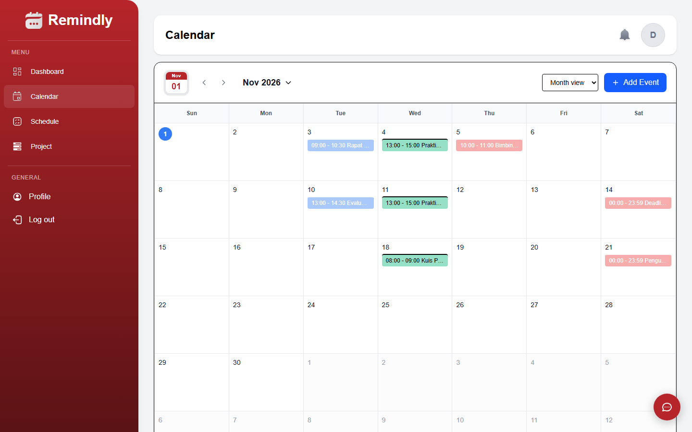
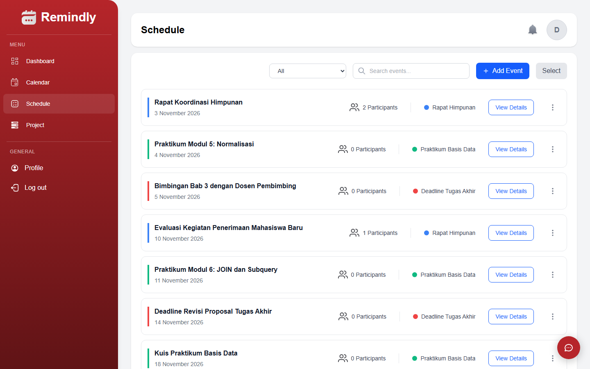
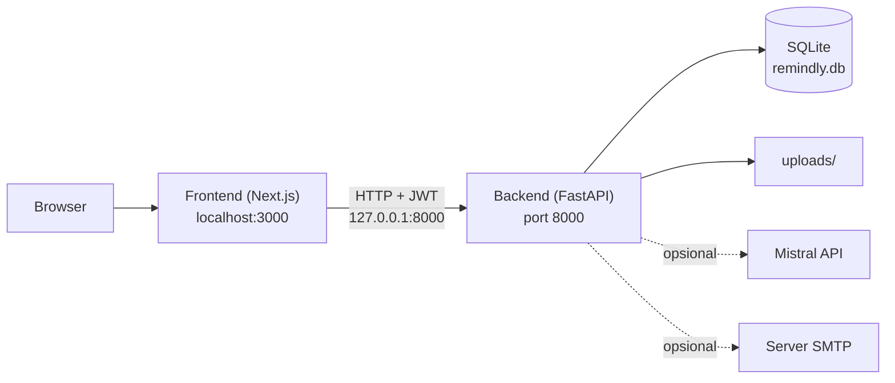

# Remindly

Sistem manajemen jadwal dan kegiatan berbasis web dengan fitur bantuan AI (Mistral).



## Deskripsi

**Remindly** adalah aplikasi web untuk membantu civitas akademika mengelola jadwal dan kegiatan, seperti rapat, praktikum, bimbingan, dan tenggat tugas. Pengguna dapat membuat event, mengelompokkannya ke dalam project, mengundang peserta, dan melihat jadwal dalam tampilan kalender atau daftar.

Aplikasi ini menggabungkan autentikasi berbasis JWT, manajemen event dan project, serta beberapa fitur berbasis Mistral AI: pembuatan pengingat dalam Bahasa Indonesia, asisten jadwal berbasis percakapan, saran waktu alternatif ketika terjadi bentrok jadwal, dan pembuatan draf email undangan.

## Fitur

**Autentikasi dan akun**
- Registrasi dan login dengan JWT (access token dan refresh token)
- Password di-hash dengan bcrypt
- Pencatatan percobaan login gagal
- Reset password melalui permintaan token (`/request-reset`) dan penetapan password baru (`/reset-password`)
- Profil pengguna: ubah data (nama, tanggal lahir, telepon, negara, kota) dan unggah foto profil (JPEG, PNG, GIF, WebP)

**Event dan kalender**
- CRUD event dengan judul, deskripsi, tanggal mulai dan selesai, waktu, dan opsi seharian
- Jika tanggal selesai tidak diisi, event dianggap berlangsung satu hari
- Daftar peserta (guest) disimpan sebagai teks CSV dan dihitung jumlahnya
- Jenis rapat: Online (dengan tautan) atau Onsite (dengan lokasi)
- Pengambilan event berdasarkan rentang tanggal untuk tampilan kalender
- Tampilan kalender bulanan dan mingguan

**Project**
- CRUD project dengan nama dan warna
- Nama project harus unik per pengguna
- Jumlah event (meeting) pada setiap project dihitung otomatis
- Daftar event per project

**Notifikasi**
- Daftar notifikasi, jumlah notifikasi belum dibaca, tandai sudah dibaca (satu atau semua), dan hapus notifikasi
- Pengingat untuk tugas yang akan datang dibuat oleh AI (`/notifications/upcoming`)

**Fitur AI (membutuhkan `MISTRAL_API_KEY`)**
- Asisten jadwal berbasis percakapan (`POST /ai/chat`)
- Pembuatan pengingat untuk event hari ini, dijalankan paralel dengan cache di memori selama 1 jam
- Saran waktu alternatif untuk event yang bentrok, dalam jam kerja 07:00 sampai 22:00 dan tidak memilih waktu yang sudah lewat (`POST /ai/suggest-alternative-times`)
- Pembuatan draf email undangan dalam Bahasa Indonesia, dengan templat berbeda untuk rapat Online dan Onsite (`POST /events/{event_id}/invite`)
- Penguraian kalimat bahasa natural menjadi data event (`POST /ai/parse-task`)

## Tangkapan Layar

| Kalender | Jadwal |
|---|---|
|  |  |
| Tampilan kalender bulanan dengan event dan tombol tambah event. | Daftar event dengan jumlah peserta, project, dan aksi detail. |

## Tech Stack

| Bagian | Teknologi |
|---|---|
| Backend | Python 3.12, FastAPI 0.120, SQLAlchemy 2.0, Pydantic 2.12, Uvicorn 0.38, python-jose, bcrypt |
| Database | SQLite (pengembangan) |
| AI | Mistral AI, model `mistral-small-latest` |
| Email | SMTP |
| Frontend | Next.js 16, React 19, TypeScript, Tailwind CSS 4, Axios |

### Arsitektur



## Memulai

### Prasyarat

- Python 3.12
- Node.js 20.9 atau lebih baru (persyaratan Next.js 16)
- Akun Mistral (opsional, hanya untuk fitur AI)
- Akun SMTP, misalnya Gmail dengan App Password (opsional, hanya untuk email undangan). Untuk uji lokal dengan Mailpit, set `SMTP_HOST=localhost`, `SMTP_PORT=1025`, `SMTP_USE_TLS=false`, dan kosongkan `SMTP_USERNAME`.

### 1. Clone repositori

```bash
git clone https://github.com/<username>/<repo>.git
cd <repo>
```

### 2. Setup backend

Jalankan perintah berikut dari folder `backend/`.

```bash
cd backend
```

Buat dan aktifkan virtual environment.

Windows (PowerShell atau Command Prompt):
```bash
py -3.12 -m venv .venv
.venv\Scripts\activate
```

macOS atau Linux:
```bash
python3.12 -m venv .venv
source .venv/bin/activate
```

Install dependensi:
```bash
pip install -r requirements.txt
pip install email-validator
```

Catatan: `email-validator` dibutuhkan oleh validasi email (Pydantic `EmailStr`), tetapi belum tercantum di `requirements.txt`. Lihat [Keterbatasan yang Diketahui](#keterbatasan-yang-diketahui).

Buat file `.env` dari templat:
```bash
cp .env.example .env
```

Buat `SECRET_KEY`:
```bash
python -c "import secrets; print(secrets.token_urlsafe(32))"
```

Isi variabel di `.env`. Nama variabel berikut diambil dari `.env.example` dan `app/config.py`:

| Variabel | Keterangan | Wajib |
|---|---|---|
| `DATABASE_URL` | Koneksi database, misalnya `sqlite:///./remindly.db` | Ya |
| `SECRET_KEY` | Kunci penandatanganan JWT | Ya |
| `ALGORITHM` | Algoritma JWT (contoh: `HS256`) | Ya |
| `ACCESS_TOKEN_EXPIRE_MINUTES` | Masa berlaku access token, dalam menit | Ya |
| `REFRESH_TOKEN_EXPIRE_DAYS` | Masa berlaku refresh token, dalam hari | Ya |
| `SMTP_HOST` | Host server SMTP | Ya* |
| `SMTP_PORT` | Port server SMTP | Ya* |
| `SMTP_USERNAME` | Username SMTP | Ya* |
| `SMTP_PASSWORD` | Password SMTP (untuk Gmail, gunakan App Password) | Ya* |
| `EMAIL_FROM` | Alamat pengirim email | Ya* |
| `MISTRAL_API_KEY` | API key Mistral untuk fitur AI (`config.py` juga membaca nama `MISTRAL_API`) | Tidak |

\* Variabel SMTP ditandai wajib karena `app/config.py` tidak memberi nilai default. Aplikasi tidak dapat dijalankan jika variabel ini belum diisi, meskipun email tidak digunakan.

Jalankan backend dari folder `backend/`, karena `config.py` membaca `.env` dari direktori kerja:
```bash
uvicorn app.main:app --host 127.0.0.1 --port 8000 --reload
```

Tabel database dibuat otomatis saat aplikasi dijalankan. Skrip `bootstrap_db.py` dapat dipakai untuk membuat tabel secara manual. Jika Anda memiliki database SQLite lama, jalankan `migrate_db.py` sekali untuk menambahkan kolom yang belum ada.

Setelah berjalan, dokumentasi API tersedia di:
- Swagger UI: http://127.0.0.1:8000/docs
- ReDoc: http://127.0.0.1:8000/redoc

#### Mendapatkan API key Mistral (opsional)

1. Daftar di https://console.mistral.ai/
2. Buat API key
3. Salin ke `MISTRAL_API_KEY` di `.env`

#### Menyiapkan Gmail SMTP (opsional)

1. Aktifkan verifikasi dua langkah di akun Google
2. Buat App Password di pengaturan keamanan Google
3. Gunakan App Password sebagai `SMTP_PASSWORD`

### 3. Setup frontend

Buka terminal baru dan jalankan dari folder `frontend/`.

```bash
cd frontend
npm install
```

Mode pengembangan:
```bash
npm run dev
```

Atau mode produksi lokal:
```bash
npm run build
npm start
```

Frontend berjalan di http://localhost:3000.

### Port yang wajib digunakan

Alamat backend di-hard-code di frontend (`frontend/app/api/axiosClient.ts` dan beberapa halaman), dan CORS di backend hanya mengizinkan origin `localhost:3000` dan `localhost:8000` (beserta varian `127.0.0.1`). Karena itu:
- Backend harus berjalan di port **8000**.
- Frontend harus berjalan di port **3000**.

## Pengujian

Repositori ini belum memiliki test otomatis (unit, integrasi, maupun end-to-end). Verifikasi dilakukan secara manual melalui Swagger UI (`/docs`) dan antarmuka frontend.

### Verifikasi manual 1 November 2026

Pengujian dilakukan dengan HTTP langsung ke backend lokal (port 8000) menggunakan akun demo.

| Endpoint | HTTP | Hasil |
|---|---|---|
| `GET /user-dashboard` (token pengguna biasa) | 200 | Pesan selamat datang untuk pengguna |
| `GET /admin-dashboard` (token pengguna biasa) | 403 | Ditolak sesuai role |
| `GET /user-dashboard` (tanpa token) | 422 | Header `Authorization` wajib ada |
| `POST /events` (dengan tamu) | 200 | Event berhasil dibuat |
| `POST /ai/chat` (pertanyaan jadwal minggu ini) | 200 | `type: error`, Mistral 429 |
| `POST /ai/chat` (permintaan membuat event lengkap) | 200 | `type: error`, Mistral 429 |
| `GET /notifications/upcoming` | 200 | Pengingat dan ringkasan berupa teks cadangan |
| `POST /ai/suggest-alternative-times` (bentrok yang sengaja dibuat) | 200 | Tiga slot dari aturan cadangan (08:30, 10:30, 14:00) |
| `POST /ai/parse-task` (`user_input`) | 200 | Body diterima; `type: error` karena Mistral 429 |
| `POST /events/{id}/invite` (SMTP lokal Mailpit, `SMTP_USE_TLS=false`) | 200 | `sent: 1`; Mailpit menerima "Undangan Acara: ..." |

Seluruh permintaan ke Mistral ditolak dengan HTTP 429, jadi tidak ada respons AI yang berhasil. Tangkapan layar asisten belum dibuat karena belum ada jawaban AI yang bisa ditampilkan.

Skrip `backend/reproduce_issue.py` membaca kredensial dari `REMINDLY_TEST_EMAIL` dan `REMINDLY_TEST_PASSWORD`, dan berhenti dengan pesan jika keduanya belum diisi.

Skrip lint untuk frontend tersedia:
```bash
cd frontend
npm run lint
```

## Referensi API

Daftar lengkap dan skema request/response tersedia di Swagger UI (`/docs`). Tabel berikut memuat endpoint utama.

| Metode | Endpoint | Keterangan | Auth |
|---|---|---|---|
| POST | `/register` | Registrasi pengguna | Tidak |
| POST | `/login` | Login, mengembalikan access dan refresh token | Tidak |
| POST | `/refresh` | Menerbitkan token baru (refresh token dirotasi) | Tidak |
| POST | `/logout` | Menghapus refresh token pengguna | Refresh token di body |
| POST | `/request-reset` | Meminta token reset password | Tidak |
| POST | `/reset-password` | Menetapkan password baru dengan token reset | Tidak |
| GET | `/me` | Data pengguna yang sedang login | Ya |
| PUT | `/profile` | Ubah data profil | Ya |
| POST | `/upload-profile-picture` | Unggah foto profil | Ya |
| GET | `/events` | Daftar event | Ya |
| POST | `/events` | Buat event | Ya |
| GET | `/events/{event_id}` | Detail event | Ya |
| PUT | `/events/{event_id}` | Ubah event | Ya |
| DELETE | `/events/{event_id}` | Hapus event | Ya |
| GET | `/events/range` | Event dalam rentang tanggal | Ya |
| POST | `/events/{event_id}/invite` | Buat dan kirim undangan (AI) | Ya |
| GET | `/projects` | Daftar project | Ya |
| POST | `/projects` | Buat project | Ya |
| GET | `/projects/{project_id}` | Detail project | Ya |
| PUT | `/projects/{project_id}` | Ubah project | Ya |
| DELETE | `/projects/{project_id}` | Hapus project (beserta event di dalamnya) | Ya |
| GET | `/projects/{project_id}/events` | Event dalam project | Ya |
| GET | `/notifications` | Daftar notifikasi | Ya |
| GET | `/notifications/upcoming` | Pengingat tugas mendatang (AI) | Ya |
| GET | `/notifications/count` | Jumlah notifikasi belum dibaca | Ya |
| POST | `/notifications` | Buat notifikasi | Ya |
| PATCH | `/notifications/{notification_id}/read` | Tandai sudah dibaca | Ya |
| PATCH | `/notifications/read-all` | Tandai semua sudah dibaca | Ya |
| DELETE | `/notifications/{notification_id}` | Hapus notifikasi | Ya |
| POST | `/ai/chat` | Asisten jadwal (AI) | Ya |
| POST | `/ai/suggest-alternative-times` | Saran waktu alternatif (AI) | Ya |
| POST | `/ai/parse-task` | Penguraian kalimat menjadi data event (AI) | Ya |
| GET | `/health` | Pemeriksaan kesehatan layanan | Tidak |

## Keamanan

- Password di-hash dengan bcrypt. Password dipotong 72 karakter sebelum di-hash, sesuai batas bcrypt.
- Access token dan refresh token dibuat dengan JWT. Setiap panggilan `/refresh` menerbitkan refresh token baru, dan `/logout` menghapus refresh token yang tersimpan.
- Percobaan login gagal dihitung pada field `failed_login_attempts` dan direset setelah login berhasil.
- Unggahan foto profil dibatasi pada tipe JPEG, PNG, GIF, dan WebP.
- Kredensial dan konfigurasi dibaca dari `.env`, bukan ditulis di kode. File `.env` tidak boleh masuk ke repositori.
- Akses data dilakukan melalui SQLAlchemy ORM, dan data project difilter berdasarkan pemilik.

## Struktur Project

```
remindly/
├── backend/
│   ├── app/
│   │   ├── main.py            # Aplikasi FastAPI dan seluruh endpoint
│   │   ├── config.py          # Pengaturan dari .env (pydantic-settings)
│   │   ├── database.py        # Koneksi SQLAlchemy dan init_db()
│   │   ├── models.py          # Model SQLAlchemy (User, Project, Event, Notification)
│   │   ├── schemas.py         # Skema Pydantic
│   │   ├── auth_utils.py      # JWT dan hashing password
│   │   ├── ai_service.py      # Integrasi Mistral AI
│   │   └── email_service.py   # Pengiriman email SMTP
│   ├── uploads/               # Foto profil yang diunggah
│   ├── bootstrap_db.py        # Inisialisasi database
│   ├── migrate_db.py          # Migrasi skema SQLite (dijalankan sekali untuk database lama)
│   ├── migrate_profile.py     # Skrip database tambahan
│   ├── add_meeting_type.py    # Skrip database tambahan
│   ├── reproduce_issue.py     # Skrip reproduksi isu
│   ├── requirements.txt
│   └── .env.example
├── frontend/
│   ├── app/                   # Halaman dan komponen Next.js (App Router)
│   ├── contexts/              # ChatContext dan UserContext
│   ├── public/                # Aset SVG
│   ├── package.json
│   └── tailwind.config.ts
├── assets/
│   └── screenshots/           # Tangkapan layar untuk README
└── README.md
```

## Status

Proyek dalam pengembangan dan belum di-deploy. Backend dan frontend telah dijalankan secara lokal untuk membuat tangkapan layar di atas.

Hasil verifikasi manual pada 1 November 2026 (rincian di bagian [Pengujian](#pengujian)):

- **Berhasil:** `/user-dashboard` mengembalikan 200 untuk pengguna biasa dan `/admin-dashboard` menolak pengguna non-admin dengan 403. `requirements.txt` sudah UTF-8 dan memuat `email-validator`. Pembuatan event, `/notifications/upcoming`, dan `/ai/suggest-alternative-times` mengembalikan 200.
- **Belum terverifikasi dengan Mistral:** seluruh permintaan ke API Mistral pada sesi ini ditolak dengan HTTP 429 (`Rate limit exceeded`), sehingga belum ada jawaban AI yang berhasil. Pengingat, saran waktu, dan draf undangan yang tampil berasal dari teks cadangan.
- **Berhasil setelah perbaikan:** email undangan terkirim ke Mailpit, dan `/ai/parse-task` menerima body JSON (respons AI-nya masih menunggu kuota Mistral).

## Keterbatasan yang Diketahui

- **Alamat API dan port di-hard-code.** Frontend memanggil `http://127.0.0.1:8000`, dan CORS hanya mengizinkan `localhost:3000` dan `localhost:8000`. Backend harus berjalan di port 8000 dan frontend di port 3000. Mengubah port memerlukan perubahan di kode frontend dan konfigurasi CORS di `backend/app/main.py`.
- **SQLite hanya untuk pengembangan.** Database default berupa file lokal `remindly.db`. Konfigurasi database lain belum diuji.
- **Fitur AI membutuhkan API key Mistral dengan kuota yang tersedia.** Tanpa `MISTRAL_API_KEY`, atau saat Mistral menolak permintaan, pengingat, saran waktu, dan draf undangan memakai teks cadangan. Pada verifikasi 1 November 2026, Mistral menolak semua permintaan (HTTP 429), sehingga jawaban AI dari `/ai/chat` dan `/ai/parse-task` belum terverifikasi.
- **Akses admin belum diuji.** `/user-dashboard` dan `/admin-dashboard` memeriksa role melalui `require_roles` di `backend/app/auth_utils.py`. Pengguna biasa ditolak (403) dari `/admin-dashboard`, tetapi akun admin belum diuji pada endpoint tersebut.
- **Alur reset password belum diuji end-to-end.**
- **Menghapus project juga menghapus event di dalamnya.** Relasi di `models.py` menggunakan `cascade="all, delete-orphan"`.
- **Cache AI disimpan di memori proses.** Cache hilang saat server dimulai ulang dan tidak dibagi antar instans.
- **Tidak ada test otomatis.** Lihat bagian [Pengujian](#pengujian).

## Penulis

**Jaya Saputra** (Full-stack Developer)
LinkedIn: https://linkedin.com/in/jayasssaputra
